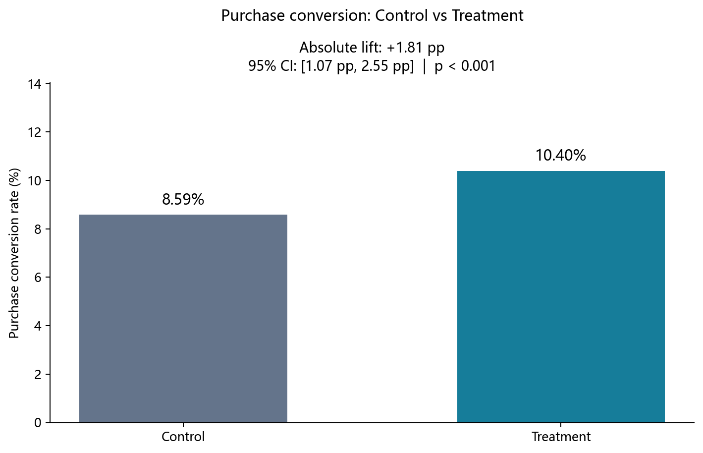
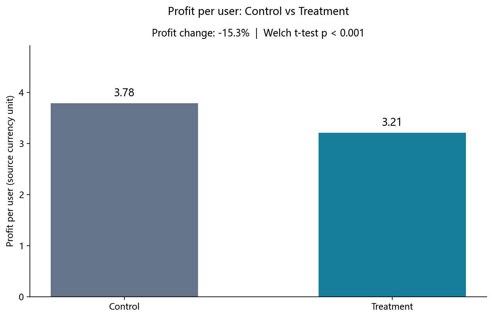
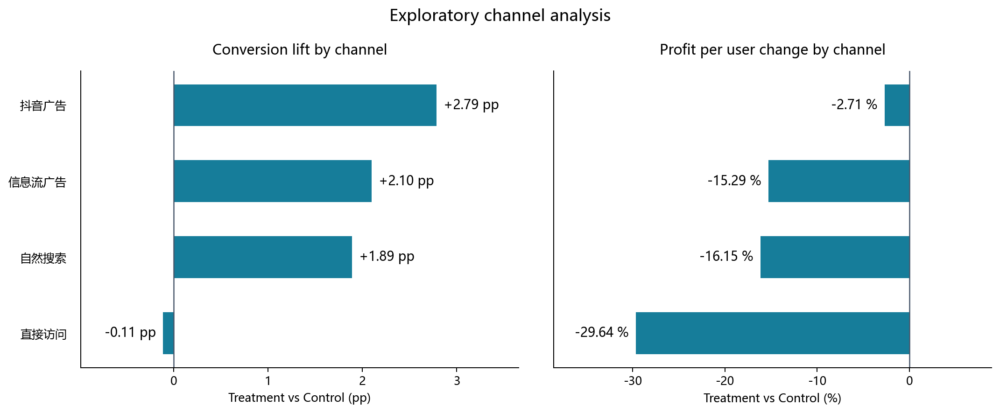

# 优惠策略 A/B Test：转化增长与利润护栏

评估新优惠策略是否值得上线：在购买转化率之外，将人均利润作为关键护栏，识别增长与盈利之间的取舍，并提出下一轮定向实验方案。

**结果摘要：** Treatment 购买转化率从 8.59% 提升至 10.40%（+1.81 pp），但人均利润下降 15.3%，两项差异均具有统计显著性。因此不建议直接全量上线；抖音广告可作为第二轮定向实验候选渠道，尚不能认定其无利润风险。

## 项目背景

优惠策略可能降低用户购买门槛，也会增加补贴成本。本项目使用仓库提供的用户级实验 CSV，对 Control 与 Treatment 进行统计比较，回答三个问题：新策略能否提高转化、是否损害人均利润、是否存在值得进一步验证的渠道机会。

本项目使用模拟用户级 A/B Test 数据，重点展示从实验设计、统计推断到业务决策的完整分析流程，不代表真实线上商业实验结果。

## 实验设计

- 分析单位：用户；每个 `user_id` 一行。
- 分组：Control（对照策略）、Treatment（新优惠策略），目标分流比例 1:1。
- 核心指标：购买转化率，即 `converted` 的均值。
- 护栏指标：人均利润；同时观察 ARPU、AOV 与人均优惠券成本。
- 推断：双侧检验，显著性水平 0.05；转化率差异方向为 Treatment − Control。

### 实验前样本量设计

为展示完整设计流程，独立补充以下事前设计情景；不声称这些参数已在原实验中预注册，也不使用观察到的提升反推事前设计。

| 设计参数 | 取值 |
| --- | --- |
| 历史 Control 转化率 | 8.5% |
| MDE（绝对差异） | 1 pp，目标转化率 9.5% |
| alpha | 0.05，双侧 |
| Power | 80% |
| Control : Treatment | 1 : 1 |
| Cohen's h | 0.03495557 |
| 每组未取整样本量 | 12847.062871 |
| 每组所需样本量（向上取整） | 12,848 |
| 总所需样本量 | 25,696 |

使用 `proportion_effectsize(0.095, 0.085)` 计算 Cohen's h，再用 `NormalIndPower().solve_power()` 求解，最后使用 `np.ceil()` 向上取整。

实际 Control 为 12,065 人、Treatment 为 11,935 人，约 12,000 人/组，略低于上述设计的理论样本量。这意味着对 1 pp 目标效应的检出能力低于设计目标，**不能据此认定实验无效**。实验后实际观察到约 1.81 pp 的提升，应通过 p-value 和 95% CI 推断实际结果。MDE 是设计时希望检出的效应大小，不是统计显著与不显著的分界线；此处不计算事后观察功效。

## 数据概况

数据共 24,000 行、10 列，覆盖日期为 2026-08-01 至 2026-08-14。日期表示记录覆盖范围，不据此推断每个用户具有相同的观察时长。

| 字段 | 含义 / 读取类型 |
| --- | --- |
| `user_id` | 用户标识，object |
| `experiment_date` | 实验记录日期，object（原始字符串） |
| `group` | 实验分组，object |
| `channel` / `user_type` / `device` | 渠道、新老用户及设备，object |
| `converted` | 购买转化标记，int64，0/1 |
| `order_amount` / `coupon_cost` / `profit` | 收入、优惠券成本、利润，float64 |

所有字段缺失值为 0；重复记录为 0；重复 `user_id` 为 0。Control 有 1,036 名转化用户，Treatment 有 1,241 名转化用户。程序输出完整字段类型和质量检查；遇到影响分析单位或分母的异常时停止，不静默删除记录。

## 实验有效性检查

先以 50:50 期望分流进行 SRM 卡方检验，再对 `channel`、`user_type`、`device` 构造列联表，检查组间分布。保留 SciPy 默认行为：自由度为 1 的列联表采用 Yates 连续性校正。

| 检查 | chi-square | 自由度 | p-value |
| --- | ---: | ---: | ---: |
| SRM (50:50) | 0.704167 | 1 | 0.401387 |
| channel | 4.680713 | 3 | 0.196726 |
| user_type | 0.182425 | 1 | 0.669298 |
| device | 0.262414 | 1 | 0.608466 |

SRM 未发现统计显著的样本比例偏离；三个已观测维度均未发现统计显著的分布差异。这些检查未提示相应异常，但不能证明随机化完美或所有潜在混杂因素都已平衡。

## 核心指标分析

| 指标 | 结果 |
| --- | ---: |
| Control 购买转化率 | 8.59% |
| Treatment 购买转化率 | 10.40% |
| Absolute lift | +1.81 pp |
| Relative lift | +21.09% |
| 两比例 Z 统计量（Control − Treatment） | -4.787378 |
| 双侧 p-value | 1.6897412e-06 |
| 差异的 95% CI（Treatment − Control） | [1.07 pp, 2.55 pp] |

Absolute lift 为两组转化率之差乘以 100，relative lift 为该差异除以 Control 转化率。两比例 Z 检验采用合并零假设方差；95% CI 保留原分析的非合并标准误 Wald 区间：`(p_t - p_c) ± 1.96 × sqrt(p_c(1-p_c)/n_c + p_t(1-p_t)/n_t)`。

p < 0.001 且区间不包含 0，购买转化率差异具有统计显著性。统计显著性需要与利润表现一起评估。



## 护栏指标分析

| 指标 | Control | Treatment |
| --- | ---: | ---: |
| ARPU | 12.339572 | 14.226023 |
| AOV（收入 / 转化用户数） | 143.703610 | 136.815141 |
| 人均优惠券成本 | 0.181102 | 1.374612 |
| 人均利润 | 3.783797 | 3.206079 |

金额单位沿用 CSV，未假设特定币种。ARPU = 总收入 / 全组用户数；人均优惠券成本与人均利润均以全组用户为分母，包含未购买用户。

**AOV 保留原口径：总收入 / 转化用户数。** 数据缺少订单数，只有每名转化用户对应一单时才等同于订单客单价；否则应理解为每位转化用户的平均收入。利润直接使用 `profit` 字段，不额外减一次优惠券成本，避免自行改变口径；上游利润核算定义仍需业务确认。

Treatment 人均利润由 3.78 降至 3.21，变化率为 -15.3%。Welch t-test 不假定等方差，t = -3.795321（Treatment − Control），p = 0.00014782952 < 0.001，差异具有统计显著性。ARPU、AOV 和优惠券成本仅进行描述性比较，没有额外显著性检验。



## 渠道异质性分析

以下为探索性渠道拆分，变化方向均为 Treatment 相对 Control；渠道利润变化率以该渠道 Control 人均利润为分母。

| 渠道 | Control 转化率 | Treatment 转化率 | Conversion lift（pp） | 人均利润变化率 |
| --- | ---: | ---: | ---: | ---: |
| 抖音广告 | 7.45% | 10.24% | +2.79 | -2.71% |
| 信息流广告 | 8.48% | 10.58% | +2.10 | -15.29% |
| 自然搜索 | 9.48% | 11.37% | +1.89 | -16.15% |
| 直接访问 | 8.72% | 8.61% | -0.11 | -29.64% |



抖音广告的转化率提升约 2.79 pp，两比例 Z = -3.955228，未经多重比较校正的 p = 7.6461792e-05 < 0.001。该渠道人均利润样本均值下降约 2.71%，Welch t = -0.315659，p = 0.752272，**当前实验未发现统计显著利润差异**，不代表两组利润相同，也不证明没有利润风险。

代码同时保留新老用户转化率的描述性拆分。渠道间点估计不同或各渠道显著性不同，不能直接证明渠道之间存在显著的处理效应差异；本项目没有增加交互项或正式异质性检验。

## 业务结论与策略建议

1. **不建议直接全量上线新优惠策略。** 转化率提升约 1.81 pp、相对提升约 21.09%，但人均利润下降约 15.3%，且利润差异具有统计显著性，现有结果不支持仅以转化增长作为上线依据。
2. **将抖音广告作为第二轮定向实验候选渠道。** 当前该渠道转化率提升约 2.79 pp，利润变化的点估计约为 −2.71%；利润检验未显著仅表示证据不足，不能认定策略一定有效且无利润风险。
3. **先设计验证，再决定推广。** 在新实验中预先明确渠道范围、转化目标、可接受的利润损失边界、观察周期及停止规则，重新设计样本量；若需要论证利润风险可控，应围绕预设边界设计非劣效检验，而不是将 p > 0.05 当作安全证据。

## 方法与技术栈

完整链路：**实验前样本量设计 → 数据质量检查 → SRM → 随机化平衡 → 转化率分析 → 两比例 Z 检验 → 95% CI → ARPU / AOV / 优惠券成本 / 人均利润 → Welch t-test → 探索性渠道分析 → 定向策略建议**。

使用 Python、Pandas、NumPy、SciPy、statsmodels 和 Matplotlib。分析采用顺序脚本，没有额外类或复杂封装；图表引用计算变量，代码不硬编码业务结论。

### 目录与复现

```text
ab-test-analysis/
├── README.md
├── requirements.txt
├── .gitignore
├── ab_test_analysis.py
├── ab_test_coupon_experiment.csv
└── images/
    ├── conversion_comparison.png
    ├── profit_comparison.png
    └── channel_effect.png
```

在该目录执行（建议 Python 3.12）：

```bash
python -m venv .venv
# Windows PowerShell
.venv\Scripts\Activate.ps1
# macOS / Linux：source .venv/bin/activate
python -m pip install -r requirements.txt
python ab_test_analysis.py
```

脚本读取与自身同目录的 CSV，输出所有统计结果并自动保存三张 PNG；使用非交互绘图后端，不会弹窗或等待关闭窗口。图表优先使用已安装的中文字体，无中文字体时自动使用英文渠道名称。运行不会修改 CSV。小数仅在展示时四舍五入。

## 项目局限

- 缺少实验分配日志、埋点与业务核算文档，不能独立验证随机化执行、用户间干扰及利润字段定义。随机化检查通过不等于证明不存在偏差。
- 样本量设计是补充的设计情景，实际约 12,000 人/组略低于目标；它与实验后 p-value / CI 推断回答不同问题，不能混用。观察到更大的提升不保证下一轮仍然出现同样效果。
- AOV 缺少订单数支持，保留收入 / 转化用户数口径；金额没有可核验的币种说明。
- 渠道及新老用户拆分属于探索性分析，多个分群比较未做多重检验校正，存在选择性发现和假阳性风险；需要独立实验验证，不能把渠道相关性或点估计差异直接解释为已验证的异质性因果结论。
- 抖音广告利润检验未显著不等于等效、非劣效或无风险；当前未为该渠道的利润护栏单独设计检验功效。
- 保留原双侧 Z 检验、Wald 区间及 Welch t-test，没有增加重采样或分布敏感性分析；尚未评估长期复购、留存、补贴持续性和用户终身价值。
